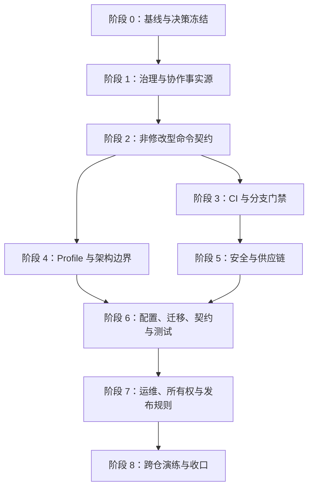

# Dify Agent API 工程治理改造开发任务拆分

## 1. 文档目的

本文将工程治理改造方案拆分为可实施、可评审、可验证的开发任务，供开发工程师排期和逐项交付。任务覆盖治理规范、非修改型验证命令、CI、架构边界、安全供应链、配置、迁移、OpenAPI、测试、运维资产和跨仓发布协作。

本文不改变现有业务功能。所有改造都必须保持认证 API 和数据库结构兼容；需要改变公开契约或生产流程的事项必须单独建立 ADR 并取得 Owner 确认。生产传输安全默认值的收紧由整改指令授权并记录在 ADR 0004，部署方需先满足其中的证书迁移条件。

## 实施进度（滚动更新）

状态只在代码、测试、文档和外部事实满足任务验收标准后更新；“已写文件”不等于完成。

| 任务 | 状态 | 完成证据或当前阻塞 |
| --- | --- | --- |
| GOV-000 | 已完成 | `docs/engineering-governance-baseline.md`；现有 `make check` 通过且无已跟踪差异；GitHub 实查确认无 Classic Branch Protection、无 Ruleset |
| GOV-001 | 已完成 | ADR 0003 固定工具、版本、锁定方式和 Check ID；所选 Git tag 已从官方仓库核验 |
| GOV-101 | 已完成 | `AGENTS.md`、`CONTRIBUTING.md`、`engineering-standards.md` 已建立唯一职责，README 已链接事实源 |
| GOV-102 | 已完成 | 唯一生效 PR 模板和 `docs/code-review.md` 已建立，治理检查阻止重复模板 |
| GOV-103 | 已完成 | `tools/governancecheck` 含 7 组正负向测试；`make governance-check`、vet、Staticcheck、全量 unit test 和链接检查通过 |
| BUILD-201 | 已完成 | 修改型 `prepare/generate/tidy/fmt` 与非修改型 `format-check/mod-check/generated-check` 已拆分；README 和贡献规范同步 |
| BUILD-202 | 已完成 | `scripts/generated-check.sh` 在 `mktemp` 中重建并逐文件比较；生成文件和 OpenAPI 漂移负向用例通过且不覆盖 fixture |
| BUILD-203 | 已完成 | `make verify` 已连续两次完整通过；内容级快照覆盖已跟踪和未跟踪文件，修改检测正负向用例通过 |
| BUILD-204 | 已完成 | `.githooks`、提交策略和暂存快照检查已落地；格式、未暂存隔离、Secret、删除文件、合法/非法标题 fixture 均通过 |
| BUILD-205 | 进行中 | 版本、镜像、Action 和 11 个真实 CI Check/调用的漂移检查已进入 `verify/CI`；仅剩受许可证审批阻塞的 `security-check` |
| CI-301 | 已完成 | 现有真实门禁拆为 11 个单职责 Job，每个 Job 只运行一个稳定 Make target；迁移、集成、E2E 各使用隔离 PostgreSQL service |
| CI-302 | 进行中 | 除 `security-check` 外的 11 个真实 Check ID 已进入 workflow；许可证 allowlist 获批前不创建虚假安全 Job |
| CI-303 | 未开始（外部阻塞） | 需先在默认分支产生全部真实 Check，再由 GitHub 管理员启用并故障注入 branch protection/ruleset |
| ARCH-401～404 | 已完成 | JSON Profile/Schema、跨事实源校验、模块/分层 import 负向测试、`architecture-check` CI 聚合均通过；并修复 platform 反向依赖 |
| SEC-501 | 已完成 | Gitleaks 同时扫描完整 Git 历史与非忽略工作树；私钥、GitHub token、数据库 URL、通用 API key fixture 均证明可阻断 |
| SEC-502 | 未开始（Owner 阻塞） | `license-report` 已可生成生产依赖清单，但 ADR 0003 要求 Owner 批准 allowlist；不得由开发者代替法律/Owner 决策 |
| SEC-503 | 已完成 | Gosec 生产包无结果；最终镜像非 root/单 binary 检查与 Grype 可修复 High 阻断真实通过，并升级 `x/crypto` 修复扫描发现 |
| SEC-504 | 未开始（依赖阻塞） | 依赖 SEC-502；当前只提供真实 `source-security-check` 与 `container-security-check` 子目标，不用残缺聚合冒充完整门禁 |
| CFG-601 | 已完成 | 配置检查已从源码正则改为 Go AST；Schema/运行时键、required、default 一致性及环境、生产 TLS、CORS、范围、超时、Secret 脱敏负向测试均通过 |
| MIG-602 | 已完成 | Git 历史确认后建立 append-only SHA-256 manifest；期望版本由 manifest 生成；历史变更、漏配对、版本跳号、生成漂移和未登记迁移负向测试通过 |
| MIG-603 | 已完成 | 隔离 PostgreSQL 17 全量 up、约束/索引/外键、down/up、重复 up、dirty/版本不符 fail-closed 均真实通过 |
| API-604 | 已完成 | 公开 HTTP 响应经 OpenAPI validator 覆盖 2xx、400、401、403、409、415、422、429、500、503、body limit 与安全错误映射 |
| TEST-605 | 已完成 | 真实 PostgreSQL 覆盖事务回滚、唯一/外键、并发 refresh 单赢、replay、撤销、过期、取消和管理员冲突 |
| E2E-606 | 已完成 | 旧失效 shell 已删除；测试构建并启动真实 `cmd/api`、轮询 readiness；真实 HTTP+PostgreSQL 覆盖健康、注册/冲突、登录、refresh replay、logout、权限输入和管理员 |
| TEST-607 | 进行中 | `verify` 已聚合已实现的 source security；完整数据库链和最终 `security-check` 仍受 SEC-502 阻塞，不能提前收口 |
| OPS-701 | 已完成 | 风险矩阵和数据分类链接真实代码/命令，并明确保留、备份、MFA、跨仓和单 Owner 残余风险 |
| OPS-702 | 未开始（外部/实现阻塞） | `docs/slo.md` 诚实记录候选目标；当前只有 trace/日志，无 metric backend、dashboard、alert 和真实窗口数据 |
| OPS-703 | 已完成 | 认证、数据库、迁移、发布/回滚 Runbook 已建立；非生产迁移、集成、E2E 恢复检查真实通过 |
| OWN-704 | 已完成（有残余风险） | 关键路径均路由至已验证账号 `@joinName177`；明确单维护者 bus factor，未伪造职责分离 |
| OPS-705 | 进行中 | Dependabot 最小权限配置和升级规则已落地；创建测试 PR/完整 Checks 需推送和 GitHub 外部状态 |
| REL-801 | 未开始（跨仓/依赖阻塞） | 依赖 TEST-607 和真实前端制品发布；本轮未获授权修改/发布前端或外部制品 |
| REL-802 | 未开始（外部阻塞） | 仓库内迁移、生成、Profile、架构、Secret、HTTP/E2E 负向测试已具备；许可证 fixture 和 Required Check 故障注入依赖 SEC-502/CI-303 |
| REL-803 | 未开始（依赖阻塞） | 需 REL-802 完成后才能安全删除 `make check` 兼容别名并确认无外部调用者 |

阶段 1 的治理检查只验证当前已经生效的治理资产、唯一位置、链接和命令入口。稳定 CI Check ID 的 workflow 对照检查将在 CI-302 实现并同步扩展同一检查器，避免在对应 Job 尚不存在时制造循环依赖。

### 代码技术债整改复核（2026-07-29）

| 项目 | 结论 | 代码事实与边界 |
| --- | --- | --- |
| 配置契约源码正则 | 已整改 | `tools/configcheck` 使用 Go AST 提取 allowlist、required/default 调用和配置读取，避免格式变化造成误判 |
| 迁移版本双写 | 已整改 | `migrations/manifest.json` 生成 `generated/migrations/version.gen.go`，运行时只引用生成常量，漂移由门禁阻断 |
| 数据库测试重复编排 | 已整改 | `database-test-prepare` 统一 manifest 校验和初始 up，迁移、集成、E2E 复用稳定入口 |
| E2E 绕过进程启动链 | 已整改 | `scripts/e2e-test.sh` 构建真实二进制，测试动态端口、轮询 readiness、信号关闭并清理临时文件 |
| 生产数据库 TLS 只禁止 disable | 已整改 | 生产仅允许 `sslmode=verify-full`，并拒绝缺失/空数据库凭据；正负向测试覆盖 |
| Cookie 安全开关零值不安全 | 已整改 | bool 改为显式策略；零值和未知值均 Secure，只有 development/test 显式允许 localhost HTTP |
| 管理员凭据轮换、全会话管理和分布式限流 | 不在本轮擅自实现 | 会改变产品权限、会话撤销或部署拓扑语义，需先确定公开契约、存储模型和运维 Owner；保留在风险矩阵而非伪装为内部重构 |

复核结论：上述前六项属于不改变业务语义、可由仓库事实验证的代码债务，已纳入本轮门禁。最后一项不是可安全推断的等价重构；在形成需求与 ADR 前强行实现会制造更大的兼容和运维债务。

## 2. 最终目标与完成定义

改造完成后，仓库必须满足以下条件：

1. 规则、架构、项目事实和 Git 流程分别具有唯一事实源，并能通过自动检查发现缺失或冲突。
2. `make verify` 是权威、非修改型、可重复执行的本地聚合门禁；执行前后 Git 工作区状态一致。
3. CI 只调用仓库内的稳定命令，每个 Required Check 使用稳定且职责单一的 ID。
4. OpenAPI、生成代码、摘要、配置 Schema 和架构 Profile 的漂移能够自动阻断。
5. Go 包依赖方向、循环依赖和跨层导入由自动化检查执行，而不只依赖代码审查。
6. 漏洞、许可证、Secret、SAST、容器和生成物供应链检查全部进入 CI。
7. 配置、迁移、HTTP 契约、PostgreSQL 集成和认证 E2E 覆盖成功、失败和恢复路径。
8. 风险矩阵、数据分类、SLO、Runbook、发布及回滚规则与实现和测试保持一致。
9. 前端锁定的 OpenAPI artifact、contract id 和 SHA-256 能通过一次完整跨仓发布演练。
10. Required Checks、CODEOWNERS 和分支保护真实生效，不依赖开发者自觉执行。

## 3. 拆分原则

- 每个任务只交付一个可以独立评审的结果。
- 先建立事实源和命令契约，再接入 CI；不得先在 CI 中维护第二套命令。
- 先实现检查器的正向和负向测试，再把检查设为阻断门禁。
- 新门禁发现存量问题时，在同一任务中修复，不建立长期 baseline 或永久豁免。
- 本地 Hook 只提供快速反馈，CI 和受保护分支是权威门禁。
- 对外部 GitHub 设置、许可证政策和跨仓发布等需要 Owner 权限的任务，明确区分“仓库内实现”和“外部启用”。

## 4. 阶段、顺序与依赖



| 阶段 | 目标 | 进入条件 | 退出条件 |
| --- | --- | --- | --- |
| 0 | 固定现状、工具选择和稳定命令名称 | 当前仓库可读取 | 决策、基线和 Check ID 已确认 |
| 1 | 建立规则唯一事实源 | 阶段 0 完成 | 治理文档和一致性检查可执行 |
| 2 | 建立非修改型本地门禁 | 阶段 1 完成 | `make verify` 可重复且不写工作区 |
| 3 | CI 复用本地命令并拆分 Check | 阶段 2 完成 | PR CI 细粒度、稳定且无命令重复 |
| 4 | 将项目事实和依赖边界机器化 | 阶段 2 完成 | Profile 和架构负向测试生效 |
| 5 | 补齐安全和供应链门禁 | 阶段 3 完成 | 安全检查进入 Required Checks |
| 6 | 闭环运行时和业务高风险验证 | 阶段 4、5 完成 | 配置、迁移、契约、集成、E2E 全部通过 |
| 7 | 建立可运营、可回滚的交付体系 | 阶段 6 完成 | SLO、Runbook、所有权和发布规范一致 |
| 8 | 验证跨仓与真实保护设置 | 阶段 7 完成 | 发布演练完成，残余风险有 Owner |

任务规模使用 `S/M/L`：`S` 表示单一文件或单一检查，`M` 表示一组紧密相关文件及测试，`L` 表示跨多个边界或需要外部系统配合。规模只用于拆分，不代表工期承诺。

## 5. 阶段 0：基线与决策冻结

### GOV-000：记录当前门禁基线

- 优先级：P0
- 规模：S
- 依赖：无
- 输出：当前 PR 描述中的基线记录；必要时补充到本文附录

实施内容：

1. 在干净工作区分别运行现有 `make check` 和 GitHub CI 等价命令。
2. 记录命令是否修改工作区、总失败点、被跳过的验证以及对 Docker/PostgreSQL 的依赖。
3. 记录当前 CI job 名称、分支保护 Required Checks 和 CODEOWNERS 实际状态。
4. 记录 OpenAPI digest、当前迁移最高版本、Go 和工具版本。

验收标准：

- 基线记录包含成功、失败、未运行和外部依赖，不只写“检查通过”。
- 能区分仓库现状问题与后续改造引入的问题。

### GOV-001：冻结工具选择与稳定 Check ID

- 优先级：P0
- 规模：M
- 依赖：GOV-000
- 输出：ADR 或 `CONTRIBUTING.md` 的决策章节

需要明确的决策：

1. Secret 扫描器及其版本锁定方式。
2. 许可证扫描器、允许许可证集合及审批责任人。
3. Go SAST 和容器扫描器。
4. 架构检查采用仓库内 Go 工具还是现有静态分析器插件。
5. Profile 使用 JSON 还是 YAML，以及 Schema 校验器。
6. CI 的稳定 Check ID、是否拆分数据库 job、缓存策略。
7. 本地 Hook 工具及是否在第一轮改造中启用。

验收标准：

- 每个工具都有选择原因、精确版本或内容摘要锁定方法、升级责任人。
- 没有同时保留两个功能重叠的扫描器作为长期实现。
- Check ID 表得到项目 Owner 确认，后续任务不得自行改名。

## 6. 阶段 1：治理与协作事实源

### GOV-101：建立治理文档职责边界

- 优先级：P0
- 规模：M
- 依赖：GOV-001
- 新增：`AGENTS.md`、`CONTRIBUTING.md`、`engineering-standards.md`
- 修改：`README.md`、`docs/go-backend-architecture.md`

实施内容：

1. `AGENTS.md` 只定义 Agent 工作方式、开工检查、范围控制、验证和交付格式。
2. `CONTRIBUTING.md` 只定义分支、Commit、PR、Review、Required Checks 和合并流程。
3. `engineering-standards.md` 定义 Go、错误、Context、并发、配置、依赖、生成代码和测试规则。
4. 保留 `docs/go-backend-architecture.md` 为架构边界唯一事实源，不新增内容重复的第二份架构文档。
5. README 只提供上手入口并链接上述事实源。

验收标准：

- 同一规则只存在于一个权威文件。
- 文档交叉引用全部有效。
- 不把架构规则复制进 `AGENTS.md`。

### GOV-102：建立 PR 与 Review 证据模板

- 优先级：P1
- 规模：S
- 依赖：GOV-101
- 新增：`.github/pull_request_template.md`、`docs/code-review.md`

PR 模板至少覆盖：

- 用户或系统结果、范围和非目标。
- 受影响的模块、身份、权限、配置、OpenAPI 和数据库。
- 迁移锁影响、兼容性、发布、停止放量和恢复方式。
- 成功、失败、边界、安全、并发和取消测试证据。
- 执行的完整命令及结果摘要。

验收标准：

- 模板位于 GitHub 实际生效路径。
- Review 清单引用权威规范，不发明另一套强制规则。

### GOV-103：实现治理一致性检查

- 优先级：P1
- 规模：M
- 依赖：GOV-101、GOV-102
- 新增：`scripts/governance-check.go` 或等价仓库内工具及测试

检查内容：

- 必需治理文件存在。
- PR 模板位于唯一生效位置。
- 不存在嵌套或工具专属的重复 Agent 指令。
- CI 包含冻结的 Required Check ID。
- README 和规范中的关键相对链接存在。
- Makefile 提供约定的稳定命令。

实施顺序说明：本任务先检查已生效治理资产、唯一位置、Markdown 链接和 `governance-check` 入口；CI-302 创建稳定 Job 时，再扩展同一检查器校验完整 Required Check ID。尚未实现的 Job 不通过临时占位伪装存在。

验收标准：

- 缺失必需文件和重复指令源都有负向测试。
- `make governance-check` 非修改并能在 CI 执行。

## 7. 阶段 2：非修改型命令契约

### BUILD-201：拆分修改型与检查型命令

- 优先级：P0
- 规模：M
- 依赖：GOV-103
- 修改：`Makefile`、`README.md`、`CONTRIBUTING.md`

实施内容：

1. 新增修改型 `make prepare`，聚合 generate、tidy 和 format。
2. 新增非修改型 `format-check`、`mod-check`、`generated-check`。
3. 使用 `go mod tidy -diff` 或临时目录比较实现 `mod-check`。
4. `format-check` 使用 `gofmt -l`，不得写回文件。
5. 旧 `make check` 暂时映射到 `make verify`；记录删除兼容别名的条件。

验收标准：

- 每个检查命令失败时返回非零状态。
- 检查命令不会修改源码、生成物、`go.mod` 或 `go.sum`。
- README 的开发流程与实际命令一致。

完成复核：`prepare` 使用显式顺序执行，避免 `make -j` 让 generate、tidy、fmt 互相竞争；`format-check` 和 `mod-check` 的人工漂移 fixture 均返回非零，正常仓库均通过。`check` 只保留到所有文档、CI 和外部调用者完成迁移，删除条件已同时写入 Makefile 和贡献规范。

### BUILD-202：实现临时目录生成漂移检查

- 优先级：P0
- 规模：M
- 依赖：BUILD-201
- 新增：生成漂移检查脚本及测试 fixture
- 修改：`Makefile`、`api/openapi/v1/oapi-codegen.yaml`（仅在需要参数化输出时）

实施内容：

1. 在 `mktemp` 创建隔离工作目录。
2. 使用锁定版本生成 OpenAPI server/model。
3. 在临时目录计算 OpenAPI SHA-256 和 digest Go 常量。
4. 逐文件比较临时生成物与已提交生成物。
5. 使用 `trap` 保证成功和失败路径都清理临时目录。

验收标准：

- 人工修改生成文件时检查失败。
- 修改 OpenAPI 但未重新生成或未更新 digest 时检查失败。
- 检查失败不覆盖用户工作区。

完成复核：实现复制 OpenAPI 与生成器配置到隔离目录，使用锁定生成器重建 server、SHA-256 和 digest，并用 `trap` 覆盖成功、失败和信号清理。`scripts/build-contract-test.sh` 已验证“手改生成文件”和“只改 OpenAPI”均失败；fixture 在失败后没有被检查器写回。现有配置无需参数化，因此没有产生无必要的配置改动。

### BUILD-203：建立权威 `make verify`

- 优先级：P0
- 规模：M
- 依赖：BUILD-201、BUILD-202
- 修改：`Makefile`

第一阶段聚合顺序：

```text
governance-check
→ format-check + mod-check + generated-check
→ vet + staticcheck + vuln-check
→ unit + race
→ build
```

后续阶段只向该入口追加已经独立通过的架构、安全、迁移、集成和 E2E 门禁。

验收标准：

- 连续执行两次结果一致。
- 执行前后的 `git status --porcelain` 完全一致。
- 任一子检查失败都会停止并返回非零状态。
- 不隐藏 warning、skip 或 flaky 结果。

完成复核：聚合顺序与本节一致，且没有调用 `generate`、`tidy` 或 `fmt`。快照不只比较状态字母，还比较相对 HEAD 的二进制 diff、未跟踪路径及其 blob hash，避免“文件仍显示 M/?? 但内容已被二次改写”的假阴性；相关负向 fixture 已通过。完整 `make verify` 连续执行两次均通过，Govulncheck 的 15 个“required module 中存在但代码不可达”结果保持原样输出，没有隐藏 warning。

边界说明：`build` 会更新本机 Docker 的 `dify-agent-api:dev` 标签，但不会修改版本化或未跟踪工作区内容；该外部构建副作用属于既有构建契约，不等同于源码写回。CI 对这些稳定目标的复用和脚本契约测试自动化归属 CI-301/CI-302，不在本阶段伪装完成。

### BUILD-204：建立版本化本地 Hook 与提交策略检查

- 优先级：P1
- 规模：M
- 依赖：BUILD-203、GOV-001
- 新增：由 GOV-001 选定的 Hook 配置、暂存快照检查脚本、Commit 消息检查配置
- 修改：`Makefile`、`CONTRIBUTING.md`

实施内容：

1. pre-commit 只检查实际暂存的新增、修改、复制和重命名文件，不把未暂存工作区混入结果。
2. 对暂存 Go 文件执行格式检查、Secret 检查和必要的受影响包测试。
3. commit-msg 检查 `type(scope): imperative summary`，type 和 scope 使用封闭集合。
4. CI 使用相同策略检查 PR 标题或最终 Squash Commit 标题。
5. Hook 只提供快速反馈；`--no-verify` 无法绕过 CI 权威检查。

验收标准：

- 未暂存错误不会让暂存快照检查产生假失败。
- 删除文件和无匹配文件能正常处理。
- 非法 Commit 消息在本地和 CI 使用同一规则失败。
- Hook 不执行 `git add -A`，也不自动提交或修改用户文件。

完成复核：版本化 `.githooks/pre-commit` 和 `commit-msg` 仅通过显式 `make install-hooks` 启用，本次开发没有改动本机 `core.hooksPath`。pre-commit 用 `git checkout-index` 建立精确暂存快照；只对 ACMR Go blob 做格式检查，Gitleaks 使用 `--pre-commit --staged`，Go/module 变化时在快照上测试。负向测试真实发现并修复了“错误读取主仓库 index”和“删除最后一个包导致假失败”两处缺陷；另已验证未暂存格式错误和未暂存 Secret 不污染结果。commit-msg 与 PR CI 均调用同一 `tools/commitpolicy`，type、scope 和标题长度规则只有一个实现。

边界说明：祈使语气的语义质量仍需 Review 判断，正则只执行可客观判定的结构、封闭集合、大小写和长度。Hook 可被 `--no-verify` 跳过，但 PR 标题会在 CI 再次执行相同规则；CI Required Check 的最终拆分和分支保护属于 CI-301～CI-303。

### BUILD-205：实现工具链一致性检查

- 优先级：P1
- 规模：S
- 依赖：BUILD-201、GOV-001
- 新增：工具链一致性检查脚本及负向测试
- 修改：`Makefile`

检查内容：

- Go 版本在 `go.mod`、构建镜像、CI 和文档中的关系符合既定策略。
- oapi-codegen、迁移、Staticcheck 和 Govulncheck 版本由唯一位置拥有。
- Docker 和 GitHub Action 使用不可变 digest 或 commit SHA。
- 必需 Make target 和 CI Check ID 完整。

验收标准：

- 人工制造任一版本漂移时检查失败并指出冲突位置。
- `make toolchain-check` 进入 `make verify` 和 CI。

当前复核：Makefile 成为工具版本 Owner；CI 已删除 oapi-codegen、Staticcheck、Govulncheck 和 migrate 的重复版本并调用稳定 Make target。检查器关联 `go.mod` language/toolchain、两类 Go 镜像、Dockerfile、README、CI 容器、OpenAPI Schema、迁移、Gitleaks、Action commit SHA 和 Make 工具调用；人工制造 Dockerfile 版本漂移、可移动 Action tag、CI 重复工具版本均由负向测试阻断。`make toolchain-check` 已进入 `verify` 和当前 CI quality job，完整 `make verify` 通过且工作区内容不变。

未完成项：工具链检查器现已校验 11 个真实 CI Check、Go/迁移/Gitleaks/Gosec/go-licenses/Grype 版本与镜像摘要。完整目标集合只缺 `security-check`；其许可证 allowlist 依法由 Owner 审批，在批准前不能用空 Job 或残缺聚合制造通过结果。因此 BUILD-205 保持进行中。

## 8. 阶段 3：CI 与分支门禁

### CI-301：让 CI 只调用 Makefile 稳定目标

- 优先级：P0
- 规模：M
- 依赖：BUILD-203
- 修改：`.github/workflows/ci.yaml`
- 可新增：`.github/actions/go-check/action.yml`

实施内容：

1. 删除 CI 中重复维护的生成器、Staticcheck 和漏洞扫描版本。
2. 每个 job 只调用一个稳定 `make <target>`。
3. 抽取 checkout、工具链和缓存等公共步骤，但不得隐藏具体检查结果。
4. 仅数据库相关 job 启动 PostgreSQL service。

验收标准：

- Makefile 与 CI 不再存在参数不同的同名检查。
- 工具版本只由一个仓库事实源拥有。
- 缓存不保存 Secret、测试数据库或不可验证生成物。

完成复核：原 `quality/container` 已拆为 11 个真实 Job：治理、格式、生成漂移、module、静态分析、架构、unit/race、迁移、PostgreSQL 集成、认证 E2E 和容器构建。每个 Job 只有一个单行 `make <stable-target>`；十个 Go Job 复用只缓存 module/build cache 的固定 SHA composite action。迁移、集成和 E2E 各自拥有隔离 PostgreSQL service，不共享数据库状态。

验收证据：Actionlint v1.7.12 和 YAML parser 均通过；七个非数据库 Make target 已用 CI 的 host-Go runner 参数逐项通过；迁移 Job 已在一次性 PostgreSQL 17.5 上真实应用 000001、000002；`container-build` 已生成带 SBOM/provenance 的测试镜像，验证后测试容器和镜像均已清理。工具链检查器同时约束 Job ID/显示名、单 Make run、checkout 数量、共享缓存使用次数和不可变 Action SHA。

### CI-302：拆分稳定 Required Checks

- 优先级：P0
- 规模：M
- 依赖：CI-301、GOV-001
- 修改：`.github/workflows/ci.yaml`、`CONTRIBUTING.md`、治理检查器

最小 Check ID：

```text
governance-check
format-check
generated-code-drift
module-check
static-analysis
architecture-check
unit-race-test
migration-check
integration-test
e2e-test
security-check
container-build
```

验收标准：

- job id、显示名称、文档和分支保护名称一致。
- PR 事件与 main push 都执行适用门禁。
- 失败能准确定位到单一质量领域。

当前进度：上列最小集合中除 `security-check` 外的 11 个 Check ID 均按同名 job id/name 建立，并同时响应 PR 与 main push。`security-check` 依赖 Owner 批准许可证 allowlist；当前真实可执行的 source/container 安全子目标不能冒充完整门禁。因此 CI-302 保持进行中，CI-303 也不能开始配置最终 Required Checks。

### CI-303：配置分支保护和合并策略

- 优先级：P0
- 规模：S
- 依赖：CI-302 全部在默认分支成功运行
- 外部变更：GitHub 仓库设置

实施内容：

- main 禁止直接推送和 force push。
- Required Checks 引用稳定 ID。
- 新提交使旧批准失效。
- 必须解决 Review 会话。
- 禁止管理员绕过；启用适合项目规模的审批数量。
- 固定 Squash Merge 标题策略并自动删除分支。

验收标准：

- 使用测试 PR 验证失败 Check 无法合并。
- 验证管理员也不能绕过。
- 将实际设置结果记录在任务或仓库治理记录中。

## 9. 阶段 4：Profile 与架构边界

### ARCH-401：建立项目 Architecture Profile

- 优先级：P1
- 规模：M
- 依赖：BUILD-203、GOV-001
- 新增：`architecture-profile.json`、`architecture-profile.schema.json`

Profile 至少包含：

- project、owner、runtime、modules。
- Go、PostgreSQL 和迁移工具基线。
- OpenAPI contract id、artifact、digest file、SHA-256。
- 认证策略、数据分类和部署制品类型。
- 关键运行目标和所有权。

验收标准：

- Schema 使用 `additionalProperties: false`。
- 必需字段、枚举、格式和冲突组合有负向 fixture。
- Profile 不复制长篇架构说明，只保存可校验项目事实。

### ARCH-402：实现 Profile、OpenAPI 和配置交叉校验

- 优先级：P1
- 规模：M
- 依赖：ARCH-401、BUILD-202
- 新增：`scripts/profile-check.go` 及测试
- 修改：`Makefile`

检查内容：

- Profile 符合 Schema。
- OpenAPI 文件实际摘要等于 digest 文件和 Profile 值。
- Profile 模块与实际 `internal/modules` 一致。
- Profile runtime 与 Docker/入口点一致。
- 配置 Schema 所需发布字段与 Profile 约束一致。

验收标准：

- 修改任意一处 contract digest 而不更新其他位置时失败。
- 新增业务模块但未登记 Profile 时失败。

### ARCH-403：定义可执行 Go 包依赖矩阵

- 优先级：P0
- 规模：M
- 依赖：ARCH-401
- 修改：`docs/go-backend-architecture.md`、`engineering-standards.md`
- 新增：架构检查配置或规则表

规则至少覆盖：

- domain 不依赖 transport、infrastructure、platform、generated、chi、pgx。
- application 不依赖 transport、infrastructure、chi、pgx 和生成 DTO。
- infrastructure 可以实现 application port，但不依赖 transport。
- transport 可以依赖 application 和生成接口，但不直接导入 PostgreSQL实现。
- platform 不反向依赖业务模块。
- 跨模块只能通过公开 application contract。

验收标准：

- 每条规则都能映射到自动检查，不留下“原则上禁止”的模糊描述。
- 对确实无法静态表达的语义规则明确标注为 Review 检查项。

### ARCH-404：实现架构检查器及负向 fixture

- 优先级：P0
- 规模：L
- 依赖：ARCH-403
- 新增：架构检查器、合法与非法 fixture、测试
- 修改：`Makefile`、CI

实施内容：

1. 基于 `go list -deps -json` 或已批准工具读取包依赖。
2. 以完整 module import path 匹配边界，避免简单字符串误报。
3. 检查循环依赖、跨层导入和跨模块深层导入。
4. 为每条禁止规则建立最小非法 fixture。

验收标准：

- 所有非法 fixture 都能明确指出来源包、目标包和违反规则。
- 合法 fixture 与当前生产代码通过。
- `make architecture-check` 进入 CI 和 `make verify`。

## 10. 阶段 5：安全与供应链

### SEC-501：接入 Secret 扫描

- 优先级：P0
- 规模：M
- 依赖：CI-302、GOV-001
- 新增：扫描器配置、测试 fixture
- 修改：Makefile、CI、`.gitignore`

实施内容：

- PR 扫描新增和修改内容。
- 对默认分支或定期任务扫描完整 Git 历史。
- 允许规则必须精确到测试 fixture 路径和假值，不允许全局排除。
- 扫描日志不得回显 Secret 原文。

验收标准：

- 私钥、GitHub token、数据库凭据和通用 API key fixture 均能触发失败。
- 如果历史中发现真实 Secret，先轮换再清理；不得只增加 ignore。

### SEC-502：建立许可证门禁

- 优先级：P1
- 规模：M
- 依赖：GOV-001、CI-302
- 新增：许可证 allowlist、扫描脚本或配置
- 修改：Makefile、CI、CONTRIBUTING

实施内容：

- 只扫描进入生产制品的依赖，同时单独报告构建工具依赖。
- 明确未知、双许可证和间接依赖的处理方式。
- 许可证例外必须有 Owner、原因和到期条件；不允许永久无主例外。

验收标准：

- 未批准许可证和未知许可证都会阻断。
- 报告能定位 module、版本和许可证来源。

### SEC-503：接入 Go SAST 和容器扫描

- 优先级：P1
- 规模：M
- 依赖：CI-302、GOV-001
- 修改：Makefile、CI、Dockerfile（仅修复发现的问题）

检查内容：

- Go 安全模式和危险 API。
- 容器 OS 包和 Go binary 依赖漏洞。
- 最终镜像以非 root 运行。
- 镜像不包含 `.env*`、`.git`、源码、测试凭据和构建工具。
- SBOM 和 provenance 作为 CI 制品保存。

验收标准：

- 高危且存在修复版本的生产漏洞阻断。
- 无修复版本漏洞必须有显式风险处置和 Owner，不得静默忽略。

### SEC-504：聚合 `security-check`

- 优先级：P0
- 规模：S
- 依赖：SEC-501、SEC-502、SEC-503
- 修改：Makefile、CI

验收标准：

- `make security-check` 聚合 govulncheck、Secret、许可证、SAST 和适用的容器检查。
- CI 的 `security-check` 使用同一入口。
- 非容器环境无法执行的检查拆为明确子目标，`make verify` 不得假装已验证。

## 11. 阶段 6：配置、迁移、契约与测试闭环

### CFG-601：校验配置 Schema 与 Go Config 一致性

- 优先级：P0
- 规模：L
- 依赖：ARCH-402
- 修改：`deploy/config.schema.json`、`internal/platform/config/*`
- 新增：Schema 契约测试

实施内容：

- 比较 Schema 字段、Go Config 字段和环境变量读取清单。
- 验证 required、default、类型、格式和范围一致。
- 只对 `DIFY_AGENT_` 前缀的未知变量执行拒绝策略，避免误判操作系统环境变量。
- 增加 production 与 development 的差异约束。
- 增加非法超时、连接池范围、CORS、弱密码和不安全 endpoint 的负向测试。

验收标准：

- Schema 新增字段但 Go 未读取时失败，反向也失败。
- 错误输出不包含密码、完整数据库 URL 或 Secret。
- `make config-check` 进入 `verify` 和 CI。

### MIG-602：建立迁移不可变性和摘要基线

- 优先级：P0
- 规模：M
- 依赖：BUILD-203
- 新增：迁移 manifest/checksum 文件及检查器
- 修改：迁移规范文档、Makefile

实施内容：

- 为现有已发布迁移建立一次性基线。
- 检查版本重复、缺失 up/down 配对、非法命名、空文件和已发布摘要变化。
- 新迁移只允许追加，不允许修改已有迁移。
- 明确哪些迁移允许 down，哪些必须使用前向修复。

验收标准：

- 修改历史迁移内容时检查失败。
- 新增迁移未更新 manifest 时检查失败。
- 基线建立过程经过人工确认，不能把未知修改直接视为可信历史。

### MIG-603：建立真实 PostgreSQL 迁移测试

- 优先级：P0
- 规模：L
- 依赖：MIG-602、CI-302
- 新增：`test/integration/migrations/*` 或等价测试工具
- 修改：Makefile、CI

测试内容：

- 空数据库执行全量 up。
- 校验最终版本和关键约束、索引、外键。
- 对声明可逆的迁移执行 up/down/up。
- 验证重复执行、失败迁移和版本不匹配的处理。
- 对不可逆迁移验证前向修复和发布说明，而不是强制伪造 down。

验收标准：

- 每次测试使用隔离数据库并可靠清理。
- 并行 CI 不共享数据库名称或 Schema。
- `migration-check` 成为独立 Required Check。

### API-604：补齐 OpenAPI 响应契约测试

- 优先级：P0
- 规模：L
- 依赖：BUILD-202、CFG-601
- 修改：OpenAPI、HTTP server 测试及错误映射测试

覆盖场景：

- 成功响应 `code` 等于 HTTP 状态且 `requestId` 存在。
- 错误响应使用稳定 `errorCode`，不泄漏内部错误。
- 非法 JSON、字段缺失、错误 Content-Type、超大 body。
- 401、403、409、429 和 5xx 安全映射。
- OpenAPI 声明的响应都能由实现产生，实现产生的响应都在契约中。

验收标准：

- 契约测试能在响应信封或状态码不一致时失败。
- 测试验证公开行为，不依赖 handler 私有实现。

### TEST-605：补齐 PostgreSQL Repository 与事务集成测试

- 优先级：P0
- 规模：L
- 依赖：MIG-603
- 新增：`test/integration` 或相邻 package 集成测试

覆盖场景：

- 唯一约束、外键和事务回滚。
- 并发注册、refresh token 原子轮换和 replay。
- Context 取消和数据库超时。
- 会话撤销、过期和清理。
- 管理员邮箱已被普通用户占用时 fail-closed。

验收标准：

- 测试使用真实 PostgreSQL，不以 mock 替代数据库语义。
- 能在旧实现或故意破坏事务边界时稳定失败。

### E2E-606：将认证 E2E 建成 CI 阻断门禁

- 优先级：P0
- 规模：L
- 依赖：API-604、TEST-605、CI-302
- 修改：`test/e2e/auth-smoke.sh` 或迁移到可维护测试程序、Makefile、CI

最小流程：

1. 启动隔离 PostgreSQL并执行迁移。
2. 启动 API 并等待 readiness，而不是固定 sleep。
3. 注册用户并验证重复邮箱冲突。
4. 验证正确和错误密码登录。
5. 验证 refresh 原子轮换及旧 token 失效。
6. 验证 logout 后会话不可继续使用。
7. 验证普通用户不能通过输入提升角色。
8. 验证 `livez`、`readyz` 和 `version`。
9. 在成功和失败路径都清理进程、容器和临时文件。

验收标准：

- 不使用真实用户、真实邮箱或生产 Secret。
- 失败日志对 Authorization、Cookie、密码和数据库 URL 脱敏。
- 测试可重复执行，不依赖顺序和固定端口。
- `e2e-test` 成为 Required Check。

### TEST-607：完成 `make verify` 最终聚合

- 优先级：P0
- 规模：M
- 依赖：ARCH-404、SEC-504、CFG-601、MIG-603、API-604、TEST-605、E2E-606
- 修改：Makefile、CONTRIBUTING、README

最终聚合建议：

```text
governance + profile + toolchain
→ format + module + generated drift
→ vet + staticcheck + architecture
→ unit + race + config contract
→ migration + PostgreSQL integration + HTTP contract
→ authentication E2E
→ build + security + container verification
```

验收标准：

- 完整验证前后工作区不变。
- 每项门禁都有独立命令，可以局部快速执行。
- 完整验证没有 warning、skip、flaky 或未解释的外部依赖失败。

## 12. 阶段 7：运维、所有权与发布规则

### OPS-701：建立需求与风险矩阵和数据分类

- 优先级：P1
- 规模：M
- 依赖：SEC-504、API-604、TEST-605
- 新增：`docs/requirements-risk-matrix.md`、`docs/data-classification.md`

风险矩阵字段：

```text
需求/风险 → 控制 → 自动验证 → 人工验证 → 残余风险 → Owner
```

至少覆盖密码、管理员初始化、token 泄漏与 replay、CORS、限流、PII、迁移、契约漂移、PostgreSQL 不可用和供应链。

验收标准：

- 每个高风险控制都链接真实代码、测试或 CI Check。
- 未自动化的控制明确标记人工步骤和 Owner。

### OPS-702：建立可测量 SLO

- 优先级：P1
- 规模：M
- 依赖：OPS-701、现有 observability 能力核验
- 新增：`docs/slo.md`
- 修改：观测代码和测试（若缺失必要指标）

实施内容：

- 定义 API 可用性、认证 p95/p99、错误率、连接池饱和度和发布失败率。
- 为每个 SLO 指定数据源、计算窗口、排除规则、告警阈值和 Owner。
- 确认日志、metric 和 trace 不包含 Secret 或完整 PII。

验收标准：

- 每个 SLO 都能由真实遥测计算；无法测量的目标不得标为已实施。
- 告警字段通过脱敏测试或评审。

### OPS-703：建立 Runbook 和发布回滚说明

- 优先级：P1
- 规模：L
- 依赖：OPS-702、MIG-603、E2E-606
- 新增：
  - `docs/runbook-authentication.md`
  - `docs/runbook-database.md`
  - `docs/runbook-migration.md`
  - `docs/release-and-rollback.md`

每份 Runbook 包含：

- 症状和触发信号。
- 安全诊断步骤。
- 禁止操作。
- 缓解、停止放量、回滚或前向修复。
- 升级 Owner 和恢复后验证。

验收标准：

- 命令在非生产环境演练通过。
- 文档不要求复制 token、密码或完整数据库 URL。
- 数据库破坏性变化明确采用 expand/backfill/cutover/contract。

### OWN-704：细化 CODEOWNERS

- 优先级：P1
- 规模：S
- 依赖：GOV-101、ARCH-401
- 修改：`.github/CODEOWNERS`

至少按以下范围分配：

- OpenAPI、迁移、认证、配置、HTTP 平台、业务模块、部署、CI、依赖文件和 ADR。

验收标准：

- 所有关键路径有 Owner。
- 不使用无效占位账号。
- 如果当前仍只有一个维护者，明确记录 bus factor 风险，而不是假装已经实现职责分离。

### OPS-705：建立依赖与工具升级策略

- 优先级：P1
- 规模：M
- 依赖：SEC-504、OWN-704
- 新增：依赖更新工具配置或定期更新 workflow
- 修改：`CONTRIBUTING.md`、`docs/release-and-rollback.md`

实施内容：

- 定期检查 Go module、Go 工具、GitHub Action commit、基础镜像 digest 和 PostgreSQL 镜像。
- 将相关安全更新分组，业务依赖升级与无关功能变更分开。
- 主版本、认证、数据库、OpenAPI 生成器和构建链升级要求 ADR 或显式迁移说明。
- 更新 PR 必须运行完整门禁并审查 release notes、许可证、漏洞、生成漂移和性能影响。
- 明确无人处理、长期失败和自动更新噪声的升级机制。

验收标准：

- 能创建一个不直接合并的测试更新 PR，并触发完整 Required Checks。
- 自动化不拥有绕过审批或直接推送 main 的权限。
- 工具和镜像锁定具备持续更新路径，而不是永久停留在初始版本。

## 13. 阶段 8：跨仓演练与收口

### REL-801：执行前后端契约同步演练

- 优先级：P0
- 规模：L
- 依赖：TEST-607、OPS-703
- 涉及仓库：`dify-agent-api`、前端 `general_architecture_projects`

演练步骤：

1. 在 API 修改一个向后兼容的 OpenAPI 示例字段或仅执行无内容变化的重新发布演练。
2. 生成 API transport、digest 和发布元数据。
3. 前端更新锁定 artifact、Profile digest 和生成客户端。
4. 分别执行 API `make verify` 与前端 `pnpm verify`。
5. 启动 SPA、API、PostgreSQL，完成认证 E2E。
6. 验证旧前端与新 API、或明确支持矩阵中的组合。
7. 演练回滚静态前端和 API 制品，确认数据库仍兼容。

验收标准：

- 契约同步步骤可重复，且不存在人工复制后未校验的文件。
- 发布顺序、兼容窗口和失败恢复写入发布文档。
- 破坏性变化必须另建 ADR，不以本演练暗示默认允许。

### REL-802：执行门禁绕过和故障注入验收

- 优先级：P0
- 规模：M
- 依赖：CI-303、REL-801

故障注入：

- 修改历史迁移。
- 手改生成代码。
- 让 Profile digest 与 OpenAPI 不一致。
- 引入非法跨层 import。
- 提交测试 Secret。
- 使用未批准许可证 fixture。
- 让认证错误响应泄漏内部错误。
- 令 E2E refresh replay 检查失败。

验收标准：

- 每个故障都被预期的唯一 Check 阻断。
- Check 输出能指导开发者修复，不泄漏敏感内容。
- 删除故障后所有门禁恢复，不依赖清缓存或人工修改外部状态。

### REL-803：关闭兼容桥和临时任务

- 优先级：P1
- 规模：S
- 依赖：REL-802

清理内容：

- 删除旧 `make check` 兼容别名，或记录明确移除版本。
- 删除旧 CI 重复命令和废弃 job。
- 删除测试临时豁免、fixture 残留和无用工具依赖。
- 更新 README 最终命令和贡献入口。

验收标准：

- 全仓搜索不存在旧命令、旧 Check ID、过期文件名和无主 TODO。
- 最终 `make verify` 和跨仓验证全部通过。

## 14. 推荐 PR 切分

| PR | 包含任务 | 说明 |
| --- | --- | --- |
| PR-01 | GOV-000～GOV-103 | 治理事实源和检查，不改变构建行为 |
| PR-02 | BUILD-201～BUILD-205 | 非修改型命令、生成漂移、Hook 和工具链一致性 |
| PR-03 | CI-301～CI-302 | CI 复用和稳定 Check；CI-303 在合并后执行 |
| PR-04 | ARCH-401～ARCH-404 | Profile、交叉校验和依赖边界 |
| PR-05 | SEC-501～SEC-504 | Secret、许可证、SAST 和容器供应链 |
| PR-06 | CFG-601、MIG-602～MIG-603 | 配置与数据库迁移闭环 |
| PR-07 | API-604、TEST-605、E2E-606～TEST-607 | 契约、集成、E2E 和最终 verify |
| PR-08 | OPS-701～OPS-703、OWN-704、OPS-705 | 风险、SLO、Runbook、所有权和依赖更新策略 |
| PR-09 | REL-801～REL-803 | 跨仓演练、故障注入和清理 |

每个 PR 都必须满足：范围单一、无无关重构、生产行为变化有自动化测试、适用门禁通过、PR 中附命令和结果摘要。

## 15. 反思与质疑：任务拆分是否完整

### 15.1 规则写出来，是否真的不会漂移

质疑：新增多份治理文档可能只是增加维护成本，并不能阻止规则冲突。

结论：只有 GOV-103 同时检查必需文件、唯一位置、稳定 Check ID 和关键交叉引用时，阶段 1 才算闭环。语义冲突仍无法完全由脚本发现，因此 Review 清单必须要求规范和实现同 PR 更新。这是无法彻底自动化的残余风险。

### 15.2 `make verify` 是否真的非修改

质疑：即使 Makefile 不调用 `gofmt -w`，生成器、Go module 下载、测试缓存、容器和测试报告仍可能写文件。

结论：BUILD-203 必须比较执行前后的 Git 状态，并明确允许写入但被 Git 忽略的缓存目录。生成器必须在临时目录运行。还应在 CI 使用只读或干净 checkout 验证。无法禁止所有工具写系统临时目录，但可以保证版本化工作区不变。

### 15.3 拆分 CI 是否只换来了更多等待时间

质疑：把一个 `quality` job 拆成多个 job 会重复 checkout、拉取镜像和下载 module，增加费用和反馈时间。

结论：拆分的价值是稳定 Required Check 和故障定位，但必须通过缓存、只在数据库 job 启动 PostgreSQL、合理组合轻量检查来控制成本。CI-301 必须采集改造前后耗时，否则可能遗留明显的性能债务。

### 15.4 架构检查能否彻底保证分层

质疑：import 图只能发现静态依赖，无法判断 Handler 是否通过 callback 间接执行 SQL，也无法判断 application 是否承担了 transport 语义。

结论：ARCH-404 可以解决显式跨层依赖和循环依赖，但不能完全替代设计审查。需要契约测试、命名规则和 Review 清单共同控制。若未来出现依赖注入容器、事件总线或代码生成桥接，应扩展检查器；当前方案不能声称彻底消除所有架构违规。

### 15.5 Profile 会不会成为新的重复配置源

质疑：Go 版本、contract digest、模块和 owner 已存在于 Makefile、Go module、OpenAPI、CODEOWNERS 或文档中，再写进 Profile 可能产生重复。

结论：Profile 只能保存需要跨资产校验的项目事实，并由 ARCH-402 验证重复值一致；可以从权威源推导的字段应由检查器读取，而不是人工重复填写。实施 ARCH-401 时必须逐字段指定 owner，否则会制造新的技术债务。

### 15.6 Secret 扫描能否解决历史泄漏

质疑：新增扫描器只能发现 Secret，无法让已经泄漏的凭据失效，也无法保证高熵但未知格式的 Secret 全部被识别。

结论：SEC-501 必须包含发现后的轮换、历史处理和审计流程。扫描器降低概率，不提供绝对保证；云平台 Secret scanning、最小权限和短期凭据仍是必要的纵深防御。任何真实泄漏都不能只靠删除 Git 内容关闭事件。

### 15.7 许可证 allowlist 是否属于开发团队单方面决策

质疑：开发工程师可能没有批准许可证的法律授权，简单复制前端 allowlist 可能错误拒绝或错误允许依赖。

结论：GOV-001 和 SEC-502 必须指定许可证政策 Owner。没有审批依据时只能生成报告，不能宣称许可证风险已经完全解决。该外部决策是阶段 5 的显式阻塞条件。

### 15.8 配置 Schema 能否完全代表真实部署环境

质疑：JSON Schema 描述字段，但未必能表达环境间组合约束、Secret 来源、部署平台注入方式和运行时网络可达性。

结论：CFG-601 解决结构和大部分组合校验，还需要部署 smoke test 验证 Secret 注入、数据库、CORS 和外部 endpoint。未知变量检查只能限定 `DIFY_AGENT_` 前缀，不能拒绝整个进程环境。Schema 不是部署验证的替代品。

### 15.9 迁移 down 测试是否会鼓励危险回滚

质疑：强制所有迁移提供 down 可能导致数据丢失，并与生产前向修复策略冲突。

结论：MIG-603 只对明确声明可逆的迁移执行 up/down/up；不可逆迁移必须提供 expand/contract 和前向修复方案。生产回滚不能默认运行 down。这样可以避免为了通过门禁伪造危险 down SQL。

### 15.10 E2E 是否覆盖了真正的前后端协作

质疑：API 仓库内部的 HTTP E2E 只能验证 API，不等于 SPA、Cookie、CORS 和浏览器行为正常。

结论：E2E-606 是 API 级阻断门禁，REL-801 才完成真实 SPA → API → PostgreSQL 验证。两者都需要，不能用一个替代另一个。跨仓演练若不进入发布流程，仍可能退化成人工一次性活动。

### 15.11 SLO 文档是否只是愿望

质疑：没有指标、仪表盘、告警和事件流程的 SLO 只是文字。

结论：OPS-702 要求每个 SLO 有真实数据源和 Owner；无法测量的目标必须标为待实施。若现有 observability 不能提供指标，需要产生新的实现任务，而不是先把文档标记为完成。

### 15.12 CODEOWNERS 是否真正解决所有权问题

质疑：所有路径仍指向同一个账号时，细分规则没有解决 bus factor，也无法实现安全、数据库和架构的独立审批。

结论：OWN-704 能建立未来可扩展结构，但无法凭代码创造真实团队角色。单维护者风险必须记录在风险矩阵中；增加备份 Owner 属于组织事项，不能被描述为工程任务已经解决。

### 15.13 分支保护是否能由仓库代码保证

质疑：workflow 和文档存在并不代表 GitHub 分支保护已启用，管理员仍可能绕过。

结论：CI-303 和 REL-802 必须在真实仓库设置中验证。若执行者没有权限，该任务应保持阻塞并由仓库 Owner 完成，不能因 YAML 已提交而宣称门禁生效。

### 15.14 是否遗漏依赖更新和门禁维护成本

质疑：精确锁定版本提高可复现性，但如果没有升级机制，会迅速积累漏洞和过期工具。

结论：OPS-705 已补充定期依赖更新策略，包括自动更新 PR、变更日志审查、工具兼容测试和镜像 digest 更新。但自动化仍依赖真实 Owner 及时处理更新；如果更新 PR 长期无人维护，锁定版本依然会成为技术债务。

### 15.15 是否遗漏备份恢复、容量和生产验证

质疑：当前任务覆盖迁移和认证故障，但数据库备份恢复、容量上限、灾难恢复和真实部署 smoke 仍不完整。

结论：这些问题超出本轮“工程治理门禁”的最小范围，却直接影响服务可运营性。应在风险矩阵登记，并创建后续 Epic：备份恢复演练、容量测试、生产部署 smoke、密钥轮换和灾难恢复。未完成前不能声称生产韧性已被彻底解决。

## 16. 完整性结论

本拆分可以完整实现原改造方案的仓库内目标，并补上了原方案没有明确展开的基线冻结、工具决策、负向 fixture、真实分支保护、跨仓契约演练和最终兼容桥清理。

但它不能单独彻底解决以下问题：

1. 组织层面的多 Owner 和独立审批能力。
2. 许可证政策的法律授权。
3. GitHub 分支保护等外部设置在无权限情况下的启用。
4. Secret 已泄漏后的平台轮换和事件响应。
5. 完整生产遥测、容量规划、备份恢复和灾难恢复。
6. 静态依赖检查无法识别的所有语义架构违规。

因此，最终交付应分为两类结论：

- “仓库工程门禁已完成”：REL-802 通过，所有仓库内检查和跨仓演练成功。
- “生产治理已完成”：还必须取得外部设置、Owner、许可证、安全响应、监控和恢复演练证据。

任何一类证据缺失时，都应把任务标记为部分完成或阻塞，而不是以文档和 CI 文件已经提交作为完成依据。

## 17. 残留技术债务登记

| 债务 | 影响 | 建议 Owner | 处理阶段 |
| --- | --- | --- | --- |
| 单一 CODEOWNER / bus factor | 无独立审批与备份维护者 | 项目负责人 | 组织治理后续 |
| 自动更新 PR 可能长期无人处理 | 精确锁定版本仍会逐渐过期 | Release/Security | OPS-705 后持续运营 |
| 完整 Git 历史 Secret 处置依赖外部平台 | 发现后仍需轮换和审计 | Security | SEC-501 后续 |
| SLO 数据源可能不完整 | 无法证明可用性目标 | Platform/Observability | OPS-702 |
| 架构语义无法完全静态检查 | 隐式反向依赖仍可能进入 | Architecture Owner | 持续 Review |
| 前后端跨仓发布非原子 | 契约兼容窗口和协调成本 | Release | REL-801 后续自动化 |
| 数据库备份恢复未演练 | 无法证明灾难恢复能力 | DBA/Platform | 独立 Epic |
| 容量和性能基线缺失 | 无法验证限流、连接池和延迟目标 | Platform | 独立 Epic |
| 生产部署 smoke 未纳入本轮 | CI 通过不代表部署平台可用 | Release | 独立 Epic |

## 18. 最终验收清单

- [ ] GOV-000～REL-803 全部有关闭证据。
- [ ] `make verify` 连续执行两次通过且不修改版本化工作区。
- [ ] Required Checks 在测试 PR 中真实阻断失败变更。
- [ ] 架构、Profile、OpenAPI、生成物、配置和迁移负向测试全部有效。
- [ ] Secret、许可证、SAST、漏洞和容器检查全部有失败 fixture。
- [ ] PostgreSQL 集成、迁移、认证 API E2E 和浏览器跨仓 E2E 通过。
- [ ] 风险矩阵中的每个控制均有代码、测试、门禁或人工 Owner。
- [ ] SLO 可以由真实遥测计算。
- [ ] Runbook 在非生产环境完成演练。
- [ ] CODEOWNERS、分支保护和合并策略在 GitHub 实际生效。
- [ ] 无临时豁免、无主 TODO、旧 Check ID、重复命令和废弃兼容桥。
- [ ] 所有残留技术债务都有 Owner、优先级和后续跟踪项。
